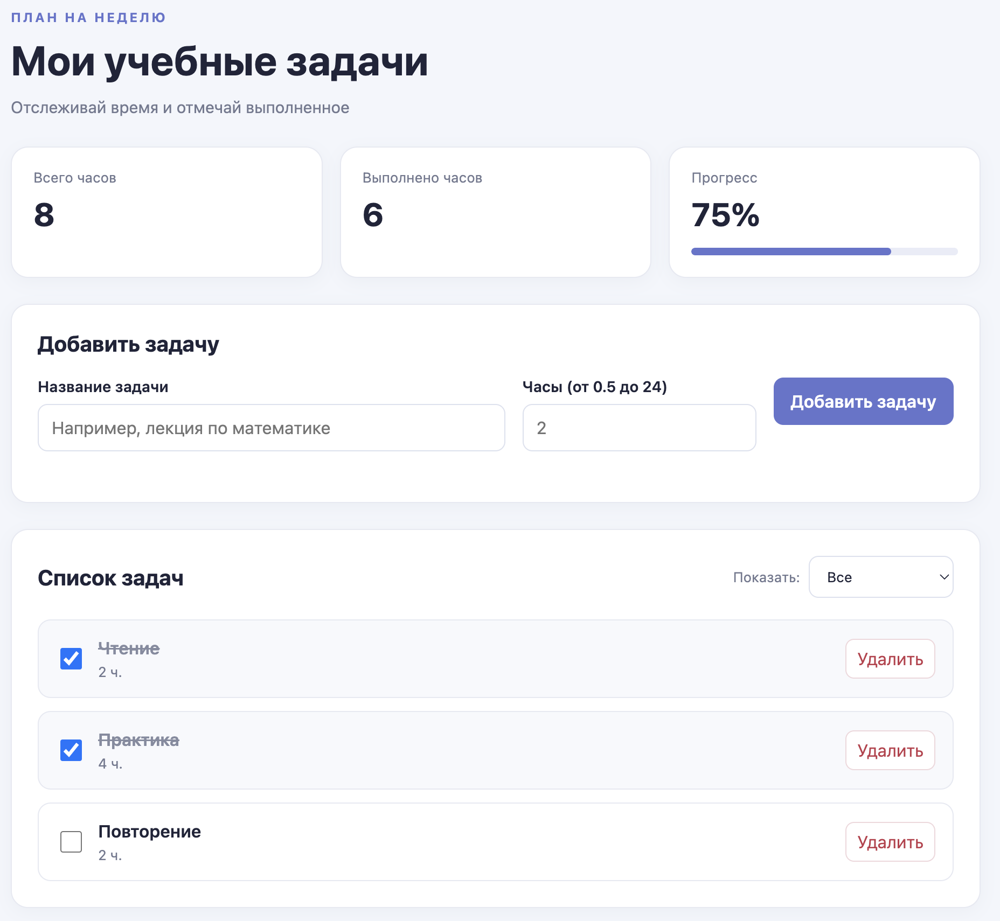
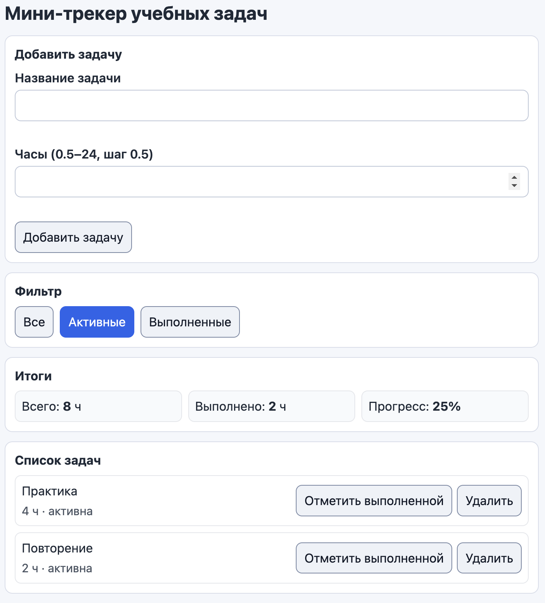

# 📚 Мини-трекер учебных задач

> Учебный проект среднего уровня **B**: мини-приложение для планирования учебной нагрузки и отслеживания выполнения задач. В репозитории представлены две реализации — `direct` и `with-spec` — для визуального и функционального сравнения подходов.

## ✨ Возможности

- Добавление учебной задачи с названием и оценкой времени.
- Отметка задачи как выполненной.
- Удаление задач из списка.
- Фильтрация задач: все / активные / выполненные.
- Подсчёт общего и выполненного времени.
- Отображение прогресса выполнения в процентах.
- Ограничение времени задачи диапазоном **0.5–24 часа** с шагом **0.5 часа** (в варианте `with-spec` это явно обозначено в интерфейсе).

## 🗂️ Структура репозитория

```text
.
├── direct/                 # Реализация без явно отображаемой спецификации
├── with-spec/              # Реализация с более явными требованиями/состояниями
├── screenshots/
│   ├── direct.png          # Скриншот direct (первый)
│   └── with-spec.png       # Скриншот with-spec (второй)
├── README.md
└── report/
    ├── comparison.md       # Сравнительный отчет
    └── comparison.pdf     # Отчет с иллюстрациями
```

> Папки `direct/` и `with-spec/` содержат исходный код реализаций. Технологии и команды запуска намеренно не указаны в README, так как их нужно сверить с фактическим содержимым проекта.

## 🖼️ Скриншоты

### 1. `direct` — первый вариант

Панель сводной статистики, форма добавления задачи и список с чекбоксами и фильтром.



### 2. `with-spec` — второй вариант

Форма с явно заданным диапазоном и шагом часов, отдельный блок фильтра, сводка и действия над активными задачами.



## 🔍 Сравнение реализаций

| Критерий | `direct` | `with-spec` |
|---|---|---|
| Представление статистики | Отдельные карточки: всего часов, выполнено часов, прогресс | Компактный блок «Итоги» с тремя показателями |
| Добавление задачи | Форма в одну строку; диапазон часов обозначен как 0.5–24 | Вертикальная форма; диапазон 0.5–24 и шаг 0.5 указаны явно |
| Выполнение задачи | Чекбокс рядом с задачей; выполненная задача зачёркнута | Кнопка «Отметить выполненной»; активность показана текстом |
| Фильтрация | Выпадающий список «Все» | Отдельные кнопки «Все / Активные / Выполненные» |
| Компоновка | Более плотная, широкая dashboard-компоновка | Более последовательная вертикальная компоновка |
| Акцент интерфейса | Быстрый обзор прогресса | Явность действий и состояний |
| По скриншоту | Видно 8 ч всего, 6 ч выполнено, прогресс 75% | Видно 8 ч всего, 2 ч выполнено, прогресс 25% |

Подробный анализ, выводы и ограничения приведены в [сравнительном отчёте](report/comparison.md).

## 🚀 Запуск

Откройте нужную реализацию в `direct/` или `with-spec/` и используйте команды запуска, предусмотренные её проектом. Перед публикацией дополните этот раздел точными командами и укажите используемый стек.

## 🎯 Итог

Проект демонстрирует два способа организовать интерфейс одного учебного трекера. `direct` делает акцент на быстром визуальном обзоре, а `with-spec` — на явных ограничениях ввода, фильтрации и действиях с задачами. Сравнение помогает оценить, как постановка и представление требований влияют на UX.

---
*Учебный проект. Скриншоты отражают состояние интерфейсов на момент демонстрации.*
