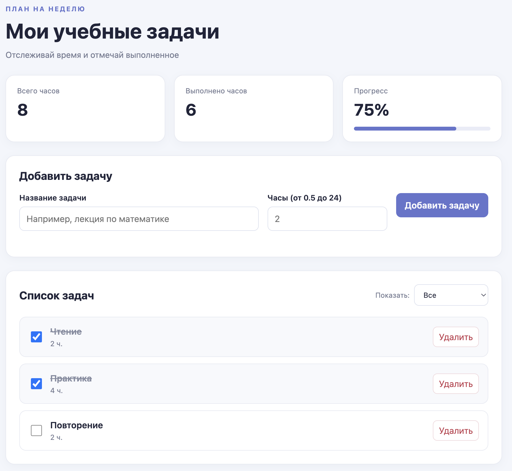
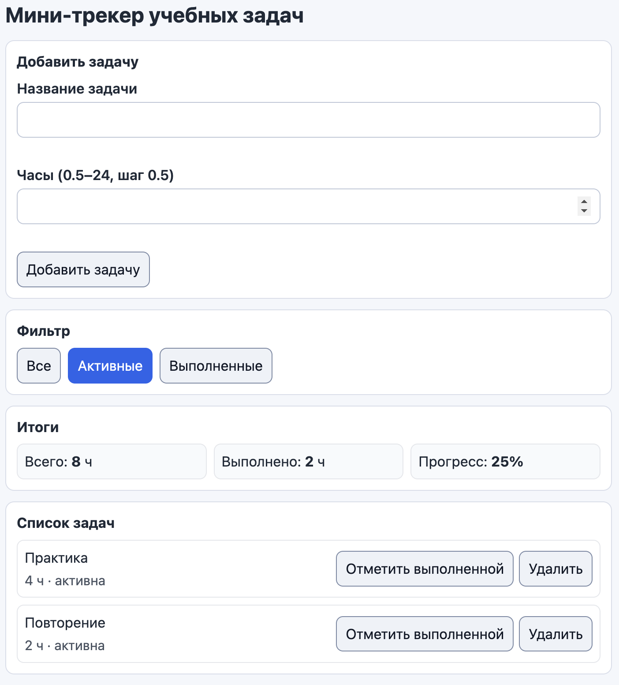

# Сравнительный отчет: мини-трекер учебных задач

## 1. Цель проекта

Разработать мини-трекер учебных задач, позволяющий задавать название задачи и планируемое время, отмечать задачи выполненными, удалять их, фильтровать список и отслеживать учебную нагрузку по суммарным часам и проценту прогресса.

В рамках проекта представлены две версии интерфейса: **`direct`** (скриншот 1) и **`with-spec`** (скриншот 2). Сравнение ниже основано на видимых элементах этих скриншотов; внутреннюю реализацию кода и технический стек по изображениям установить нельзя.

## 2. Функциональность, представленная на интерфейсах

- Добавление задачи с названием и количеством часов.
- Отображение списка учебных задач.
- Изменение статуса задачи на выполненную.
- Удаление задачи.
- Фильтрация по статусу.
- Отображение суммарных часов, выполненных часов и прогресса.

Во втором варианте диапазон ввода часов обозначен как **0.5–24 часа**, шаг — **0.5 часа**.

## 3. Сравнение интерфейсов

| Критерий | `direct` — скриншот 1 | `with-spec` — скриншот 2 |
|---|---|---|
| Общая компоновка | Широкая dashboard-компоновка, элементы расположены в несколько колонок | Вертикальная компоновка с последовательными секциями |
| Статистика | Три самостоятельные карточки; прогресс визуализирован полосой | Единый блок «Итоги» с тремя показателями |
| Форма добавления | Название, часы и кнопка находятся в одной строке | Поля размещены вертикально, кнопка ниже |
| Уточнение ввода | Подпись часов: «от 0.5 до 24» | Подпись уточняет диапазон и шаг: «0.5–24, шаг 0.5» |
| Фильтр | Выпадающий список | Кнопки «Все», «Активные», «Выполненные» |
| Отметка выполнения | Чекбокс; выполненное название зачёркнуто | Отдельная кнопка «Отметить выполненной» и текстовый статус |
| Удаление | Кнопка «Удалить» справа в строке | Кнопка «Удалить» справа в карточке |
| Визуальный акцент | Сводка прогресса и компактность | Пошаговость, читаемость секций и явные действия |

## 4. Состояния, показанные на скриншотах

### `direct` (первый скриншот)

- Всего запланировано: **8 часов**.
- Выполнено: **6 часов**.
- Прогресс: **75%**.
- В списке видны три задачи: «Чтение» (2 ч, выполнена), «Практика» (4 ч, выполнена), «Повторение» (2 ч, активна).
- Фильтр установлен на «Все».

### `with-spec` (второй скриншот)

- Всего запланировано: **8 часов**.
- Выполнено: **2 часа**.
- Прогресс: **25%**.
- Фильтр установлен на «Активные».
- В списке видны «Практика» (4 ч) и «Повторение» (2 ч), обе активны.
- Форма явно указывает диапазон 0.5–24 часа и шаг 0.5.

**Важно:** значения прогресса в изображениях различаются, потому что скриншоты демонстрируют разные состояния задач и/или фильтра. Это не следует интерпретировать как расхождение в вычислениях без проверки исходного кода.

## 5. UX-анализ

### Сильные стороны `direct`

- Сводные показатели сразу заметны благодаря отдельным карточкам.
- Полоса прогресса быстро передает долю выполненной нагрузки.
- Горизонтальная форма экономит вертикальное пространство.
- Чекбокс — привычный и быстрый способ переключить статус.

### Сильные стороны `with-spec`

- Вертикальная последовательность секций облегчает пошаговое восприятие интерфейса.
- Указание шага 0.5 часа делает ограничения ввода более понятными.
- Кнопки фильтра визуально показывают доступные режимы.
- Текстовые действия явны и не требуют интерпретации чекбокса.

### Возможные улучшения обеих версий

- Добавить сообщения об ошибках/валидации для пустого названия и некорректного времени.
- Предусмотреть подтверждение удаления или возможность отмены.
- Уточнить адаптивность на узких экранах.
- Сохранять список задач между перезагрузками (если это не реализовано).
- Добавить доступные подписи и состояния фокуса для клавиатурной навигации.
- Для статистики явно обозначать, учитываются ли все задачи или только выбранный фильтр.

## 6. Вывод

Обе версии визуально представляют базовый сценарий трекера: ввод учебной задачи, управление статусом и просмотр временной статистики.

`direct` выглядит более компактным и ориентированным на быстрый обзор: статистика вынесена в отдельные карточки, а статус переключается чекбоксом. `with-spec` организован более последовательно и явно: ограничения времени раскрыты в подписи, фильтр представлен отдельными кнопками, а выполнение — текстовой командой.

По предоставленным скриншотам нельзя сделать достоверный вывод о качестве кода, архитектуре, тестировании, доступности или фактической валидации — для этого требуется анализ содержимого папок `direct/` и `with-spec/`. В качестве визуального и UX-сравнения эти два представления демонстрируют разные приоритеты интерфейса.

## 7. Иллюстрации

### Скриншот 1 — `direct`

### Скриншот 2 — `with-spec`

